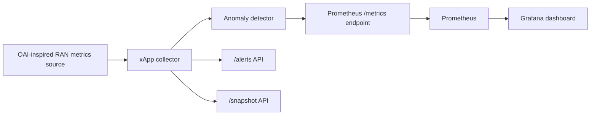

# OAI RAN Metrics xApp Lab

[](https://github.com/amandesi13/oai-ran-metrics-xapp-lab/actions/workflows/ci.yml)
[](https://www.python.org/)
[](https://prometheus.io/)
[](https://grafana.com/)
[](LICENSE)

OAI-inspired 5G RAN observability lab that simulates OpenAirInterface-style RAN metrics, collects them through an xApp-like service, detects KPI anomalies, and exports Prometheus metrics for Grafana dashboards.

This project is designed as a practical bridge between **OpenAirInterface**, **O-RAN xApps**, **RAN KPI collection**, and production-style observability. It is intentionally lightweight enough to run locally, while still showing the engineering structure expected in telecom/cloud infrastructure teams.

## Why This Project Exists

Real RAN systems produce many useful signals: PRB utilization, SINR, BLER, latency, packet loss, RRC connected UEs, throughput, and handover failures. These metrics are valuable only when they can be collected, normalized, monitored, and acted on.

This lab demonstrates that workflow end to end:

1. An OAI-inspired RAN source emits cell-level and UE-level KPIs.
2. An xApp-style collector polls those metrics.
3. Rule-based detection flags congestion, weak radio conditions, and reliability issues.
4. Prometheus scrapes the xApp.
5. Grafana visualizes RAN KPIs and active alerts.

## Architecture



## Features

- Simulated gNB/cell/UE metrics inspired by OpenAirInterface and RAN observability workflows.
- Congestion and radio-degradation scenarios.
- xApp-like polling service with `/snapshot`, `/alerts`, `/health`, and `/metrics` endpoints.
- Prometheus metrics:
  - `ran_cell_dl_prb_utilization_pct`
  - `ran_cell_ul_prb_utilization_pct`
  - `ran_cell_avg_latency_ms`
  - `ran_cell_packet_loss_pct`
  - `ran_cell_pusch_sinr_db`
  - `ran_cell_active_ues`
  - `ran_ue_bler_pct`
  - `xapp_active_alerts`
- Grafana provisioning with a starter RAN dashboard.
- Tests and GitHub Actions CI.

## Quick Start

```bash
docker compose up --build
```

Open:

- RAN source: http://localhost:8100/ran-metrics
- xApp alerts: http://localhost:8101/alerts
- xApp Prometheus metrics: http://localhost:8101/metrics
- Prometheus: http://localhost:9090
- Grafana: http://localhost:3000

Grafana login:

```text
admin / admin
```

## Run Locally Without Docker

```bash
python -m pip install -e ".[dev]"
oai-ran-source
```

In another terminal:

```bash
set RAN_SOURCE_URL=http://localhost:8100/ran-metrics
set RAN_SCENARIO=congestion
oai-ran-xapp
```

PowerShell:

```powershell
$env:RAN_SOURCE_URL="http://localhost:8100/ran-metrics"
$env:RAN_SCENARIO="congestion"
oai-ran-xapp
```

## Scenarios

The source supports:

- `normal`
- `congestion`
- `radio-degradation`

Example:

```bash
curl "http://localhost:8100/ran-metrics?scenario=radio-degradation"
```

## Example Alert

```json
{
  "severity": "critical",
  "entity": "cell-1",
  "metric": "avg_latency_ms",
  "value": 112.5,
  "threshold": 70.0,
  "message": "cell-1 latency is above threshold"
}
```

## Recruiter-Relevant Engineering Signals

This project demonstrates:

- 5G/RAN KPI modeling.
- xApp-style metric collection.
- Production-style observability with Prometheus and Grafana.
- Python service design with FastAPI and Pydantic.
- Docker Compose deployment.
- CI-backed tests.
- Telecom debugging intuition: congestion, packet loss, SINR degradation, BLER, latency, and handover failures.

## How This Maps To Real OAI Work

This repository does not vendor or run full OpenAirInterface. Instead, it provides a clean adapter boundary: replace the simulator with a real OAI metrics endpoint, log parser, E2/KPM feed, or Prometheus scrape source. The xApp and alerting logic can remain the same.

## Roadmap

- Add real OpenAirInterface log/KPI parser adapter.
- Add E2SM-KPM-inspired message schema.
- Add xChain experiment runner integration.
- Add closed-loop mitigation examples, such as alert-driven QoS policy recommendations.
- Add dashboard screenshots under `docs/`.

## License

MIT
